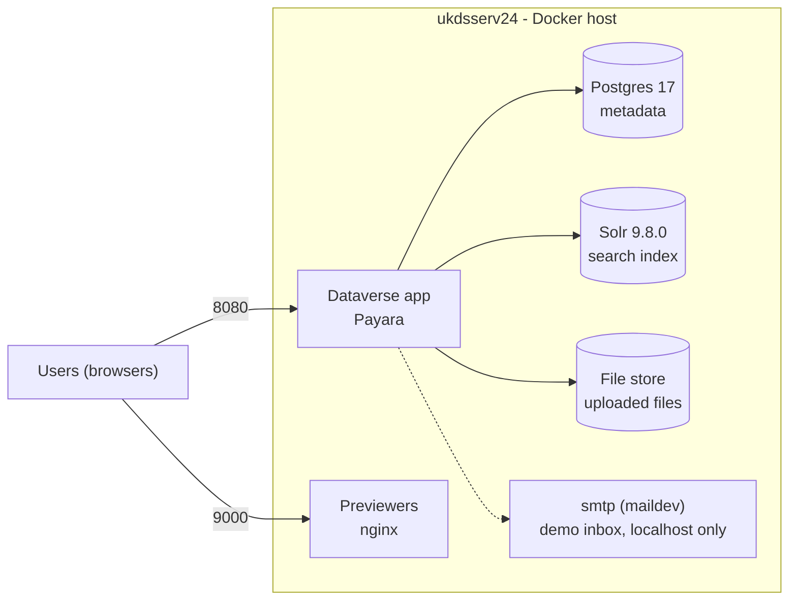

# UKDS Dataverse deployment

- **Host:** ukdsserv24 (on-prem Linux, internal only)
- **URL:** http://ukdsserv24:8080
- **Location:** `/app` (`compose.yml`, `.env`, `demo/`), run with Docker Compose
- **Components:** Dataverse app (8080), Postgres 17, Solr 9.8.0, file store, previewers (9000)
- **Open ports:** 8080 and 9000 only
- **Data:** `/app/data` (Postgres, Solr, uploaded files)
- **Secrets:** stored in the secret manager tooling (DB password, `dataverseAdmin` password).

**Operate**
- Start or apply changes: `docker compose up -d`
- Check: `docker ps -a`, `docker logs dataverse --tail 50`
- Backup: `pg_dump` of the database, plus `./data/app/data`

**To do:** 
- Pin image tags, 
- Set up a real SMTP relay
- Schedule backups
- Confirm DNS for ukdsserv24, decide on HTTPS

